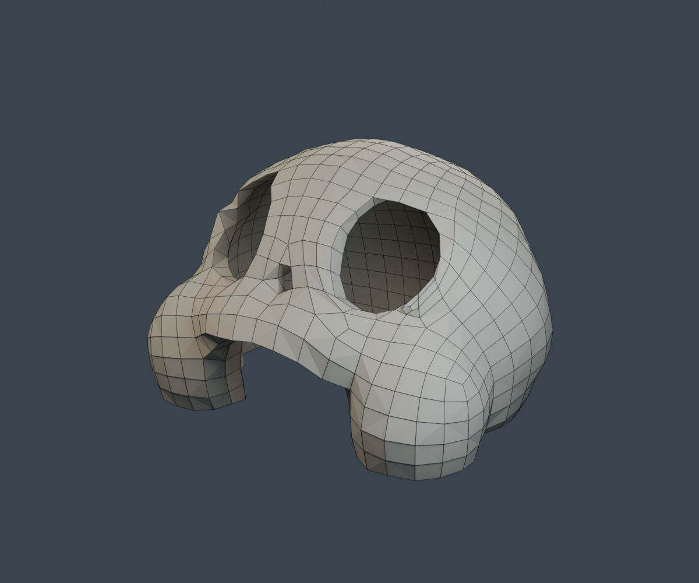
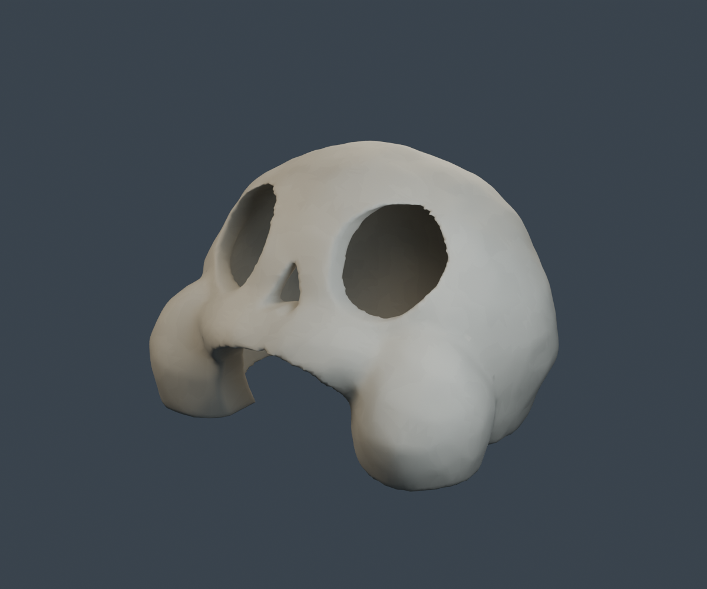

# Cueva calavera — versiones de revisión

## Versión actual: v02, malla ligera de cuadriláteros

La v02 reduce la geometría de la v01 mediante QuadriFlow, conservando el cascarón hueco, las cuatro aberturas y las medidas de 12 × 10 × 8 m. El `.blend` conserva cuadriláteros; el `.glb` los triangula según el formato glTF. El acabado usa sombreado plano y un solo material mate, sin subdivisión, desplazamiento ni texturas pesadas. La silueta, especialmente las aberturas pequeñas, es más angular.

| Métrica | v01 | v02 |
| --- | ---: | ---: |
| Caras en Blender | 19.680 triángulos | 1.139 cuadriláteros |
| Triángulos al exportar | 19.680 | 2.278 |
| Vértices de la malla en Blender | 9.836 | 1.135 |
| Tamaño del GLB | 674.416 bytes | 160.724 bytes |

Reducción del 88,42 % en triángulos equivalentes. Se verificaron una sola componente conectada, cero aristas no manifold, cero caras degeneradas y los pasos libres de boca, ojos y nariz; el modelo sigue sin suelo. La reimportación del GLB confirmó medidas, un material y número de triángulos.

- [Descargar Blender v02](https://raw.githubusercontent.com/VicTavares8/Modelado3DPublic/main/output/skull_cave_v02/skull_cave_v02.blend)
- [Descargar GLB v02](https://raw.githubusercontent.com/VicTavares8/Modelado3DPublic/main/output/skull_cave_v02/skull_cave_v02.glb)
- [Descargar paquete v02](https://raw.githubusercontent.com/VicTavares8/Modelado3DPublic/main/output/skull_cave_v02_package.zip)
- [Ver comprobaciones y recuentos exactos](output/skull_cave_v02/validation.json)




Abre el `.blend` para editar los cuadriláteros. En modo Edición (`Tab`) puedes ver las caras; el GLB importado contiene triángulos. Las líneas oscuras de la imagen de topología son una ayuda de presentación y no forman parte de los archivos del modelo.

Para reproducir la v02 en este entorno, ejecuta desde `/workspace/Modelado3DPublic`:

```bash
export XDG_CONFIG_HOME=/workspace/blender-tools/config
export XDG_CACHE_HOME=/workspace/blender-tools/cache
/workspace/blender-tools/blender-5.2.3-linux-x64/blender --background --threads 4 --python-exit-code 1 --python scripts/build_skull_cave_lowpoly.py
```

El generador lee `output/skull_cave_v01/skull_cave_v01.blend` y reemplaza únicamente las salidas de v02. Guarda tus ediciones manuales con otro nombre antes de ejecutarlo. El paquete v02 incluye ese archivo fuente para reproducir la reducción.

La reducción disminuye el coste de la geometría; el tiempo total de render también depende de resolución, muestras, iluminación y hardware. No se ha medido el rendimiento en el Mac del usuario.

## Archivo de la primera versión (v01)

Estudio inicial basado en las referencias aportadas, creado con Blender 5.2.3 LTS.

## Descargas

- [Paquete completo ZIP](https://github.com/VicTavares8/Modelado3DPublic/raw/refs/heads/main/output/skull_cave_v01_package.zip)
- [Modelo GLB](https://github.com/VicTavares8/Modelado3DPublic/raw/refs/heads/main/output/skull_cave_v01/skull_cave_v01.glb)
- [Archivo editable Blender](https://github.com/VicTavares8/Modelado3DPublic/raw/refs/heads/main/output/skull_cave_v01/skull_cave_v01.blend)



## Entrega

- `output/skull_cave_v01/skull_cave_v01.blend`: malla editable y cámaras/luces de presentación en una colección separada.
- `output/skull_cave_v01/skull_cave_v01.glb`: únicamente el cascarón y sus materiales, sin luces ni cámaras.
- `01_exterior.png`, `02_front.png`, `03_rear.png`, `04_interior.png`: vistas de revisión.

Medidas: 12 m de ancho, 10 m de fondo, 8 m de alto. Frente hacia -Y en Blender; exportación GLB con conversión estándar Y-up. Origen en el centro de la base. Sin suelo ni mobiliario. Ojos, nariz y boca abiertos, con superficies interiores y espesor real de pared.

Esta versión prioriza silueta y volumen transitable. Tiene materiales básicos de piedra, sin texturas detalladas, grietas, colisiones ni LOD. La parte trasera es una interpretación de las referencias disponibles. La forma está todavía redondeada y pendiente de revisión artística.

## Validación

19.680 triángulos y 9.836 vértices antes de exportar. La malla no presenta aristas no manifold ni caras degeneradas. Se verificaron mediante rayos la ausencia de suelo, las cuatro aberturas, techo, fondo y pared lateral. Se exportó e importó el GLB para comprobar medidas, materiales y presencia de una sola malla. El exportador puede separar vértices por UV y material.

## Reproducir en este entorno

```bash
export XDG_CONFIG_HOME=/workspace/blender-tools/config
export XDG_CACHE_HOME=/workspace/blender-tools/cache
cd /workspace/Modelado3DPublic
/workspace/blender-tools/blender-5.2.3-linux-x64/blender --background --factory-startup --threads 4 --python-exit-code 1 --python scripts/build_skull_cave.py
/workspace/blender-tools/blender-5.2.3-linux-x64/blender --background --threads 1 --python-exit-code 1 --python scripts/check_skull_cave.py
```

El generador reemplaza los archivos de salida de v01. Guarda tus ediciones manuales con otro nombre antes de ejecutarlo.

En macOS abre el `.blend` con Archivo > Abrir o importa el `.glb` con Archivo > Importar > glTF 2.0. La ejecución y las pruebas se hicieron en Linux con 5.2.3; no se ha probado la apertura en tu Mac con 5.2.2.
