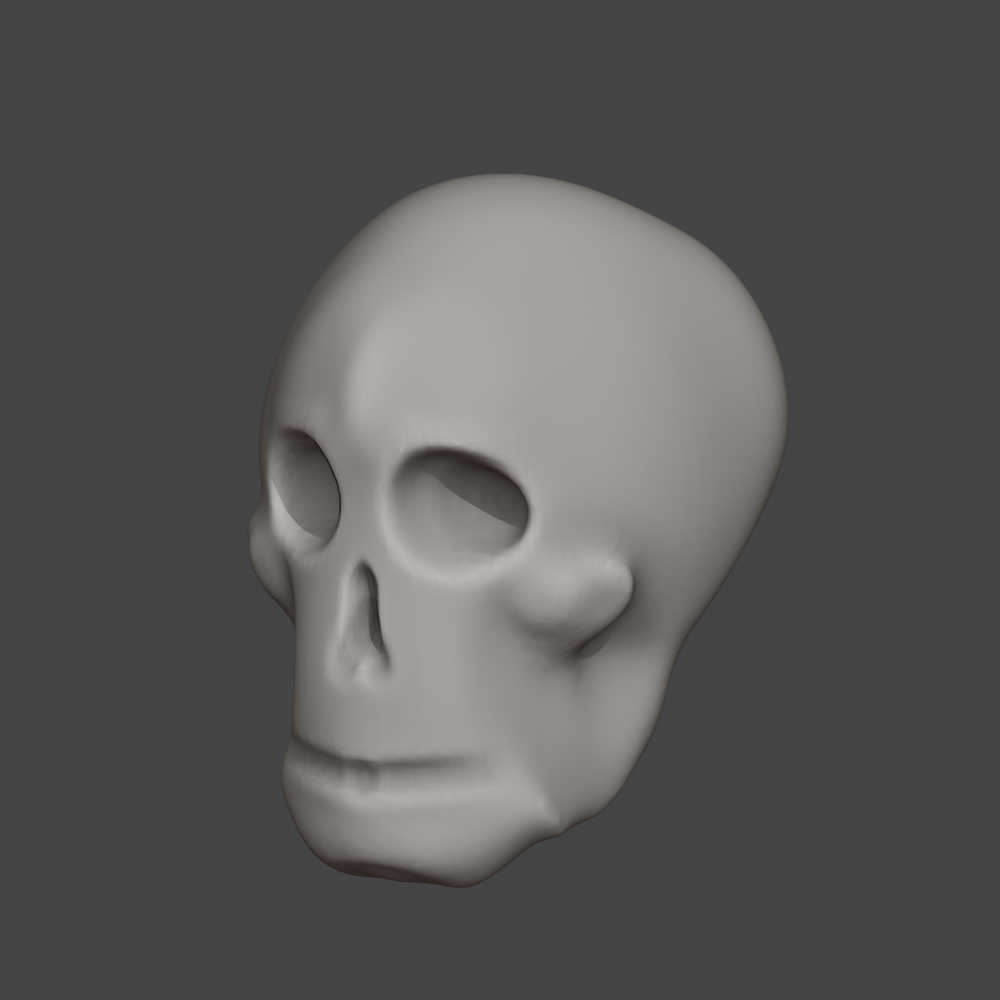

# Base de cráneo humano — revisión con referencia

Revisión de la base inicial utilizando las vistas frontal y lateral de la referencia compartida. Se corrigieron la relación entre anchura y altura, la frente, los pómulos y la mandíbula; se añadieron órbitas y nariz sencillas para que el volumen se reconozca como un cráneo humano.

Se mantiene el nivel de una **base de escultura principiante**: transiciones poco refinadas y pequeñas irregularidades. Sin dientes individuales, suturas ni detalles finos. Las cavidades son depresiones esculpidas; la mandíbula está integrada en la misma malla. No es una reconstrucción anatómica exacta de la imagen.

## Archivos

- [Blender editable — Craneo_Base.blend](Craneo_Base.blend): abre en Sculpt Mode, con simetría X activa.
- [Modelo de intercambio — Craneo_Base.glb](Craneo_Base.glb): glTF 2.0, una malla y un material gris mate, sin archivos externos ni compresión Draco.
- [Frente](frente.png) · [Perfil](perfil.png) · [Tres cuartos](tres_cuartos.png).



Altura: **22 cm**. Ancho aproximado: 15,46 cm; profundidad: 18,51 cm. Escala en metros; conversión estándar a Y-up en el GLB. Importa el GLB con la opción glTF 2.0 de tu aplicación.

## Método

Una esfera inicial trabajada con pinceles nativos de **Sculpt Mode**: Grab, Draw invertido y Smooth, con remallado voxel y simetrización X. Las pinceladas se automatizaron con Python; no es una escultura manual de una persona. No se usaron booleanos, extrusiones, ensamblaje de volúmenes ni edición directa de vértices para construir la forma. El ajuste uniforme de escala final solo fija las unidades de intercambio.

`crear_base.py` conserva la secuencia y `pinceladas.json` registra las pinceladas. La versión anterior permanece en el historial del repositorio.

## Validación

Comprobado en Blender 4.3.2: una malla conectada, cero aristas no manifold, cero caras degeneradas, cero modificadores y simetría X verificada. El GLB contiene 82.036 triángulos. Se volvió a importar y se comprobaron geometría, dimensiones, número de triángulos y material: sin diferencias de posición. Resultados en [validacion.json](validacion.json).

## Reproducir

En una instancia nueva de Blender 4.3.2, con sesión gráfica activa:

```bash
blender --factory-startup --python crear_base.py
```

No usar `--background` al generar: los pinceles requieren una vista 3D activa. El script escribe en `regenerado`, reemplaza sus salidas si existen y cierra esa instancia de Blender al terminar. Otras versiones pueden variar en el comportamiento de los pinceles.

Para comprobar los archivos entregados:

```bash
blender --background --factory-startup --python-exit-code 1 --python comprobar_base.py
```

Para comprobar otra carpeta, añadir `-- /ruta/a/la/carpeta` al final. La comprobación vuelve a escribir `validacion.json` en la carpeta revisada.
