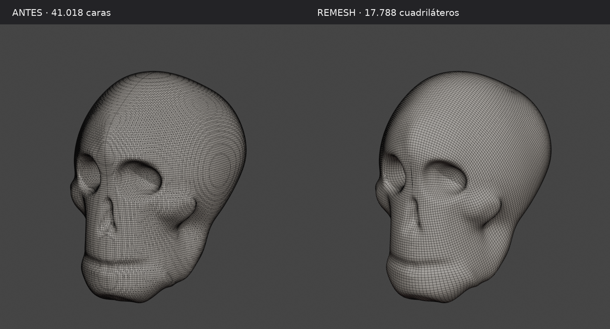
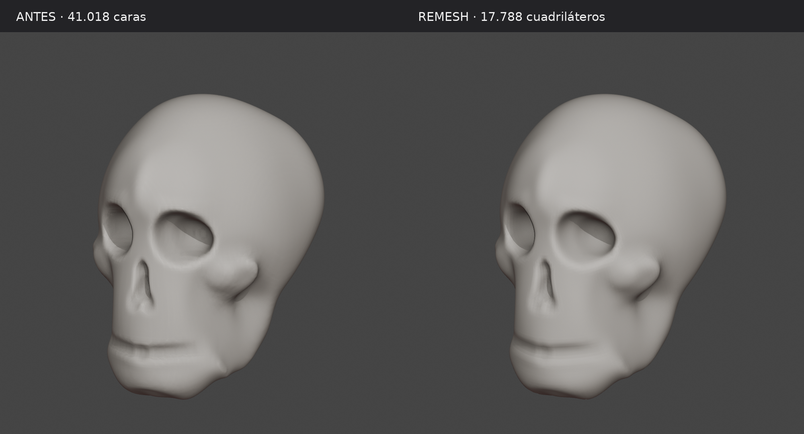

# Cráneo: remesh ligero para continuar esculpiendo

Se redujo y redistribuyó la malla de la base esculpida, conservando la silueta y los volúmenes principales. No se añadieron detalles anatómicos. La versión anterior permanece intacta en [`../craneo_base_esculpida`](../craneo_base_esculpida).

## Descargas

- [Craneo_Base_Remesh.blend](Craneo_Base_Remesh.blend): malla de cuadriláteros, abierta en Sculpt Mode con simetría X activa.
- [Craneo_Base_Remesh.glb](Craneo_Base_Remesh.glb): glTF 2.0 estándar, una malla y un material, sin dependencias externas ni Draco.

| Medida | Original | Remesh |
| --- | ---: | ---: |
| Caras en Blender | 41.018 | 17.788 |
| Vértices en Blender | 41.020 | 17.790 |
| Triángulos en GLB | 82.036 | 35.576 |

**56,63 % menos caras.** El `.blend` conserva exclusivamente cuadriláteros; el GLB los triangula por el formato de intercambio. No hay modificadores de subdivisión que vuelvan a aumentar la geometría. Altura aproximada: 22 cm; unidades en metros y conversión estándar Y-up en el GLB.

## Comparación visual



La distribución es más uniforme y reduce las agrupaciones circulares de aristas de la bóveda y los laterales. Aún existen algunos polos y bucles: no se forzó su eliminación mediante cambios en la forma del cráneo.



[Frente](frente.png) · [Perfil](perfil.png) · [Tres cuartos](tres_cuartos.png). Las aristas oscuras son una ayuda de visualización y no forman parte de los modelos entregados.

## Conservación de la forma

QuadriFlow con objetivo de 16.000 caras (resultado: 17.788), simetría X, y reproyección a la superficie original. Se soldó la unión central con tolerancia de un micrómetro y se recalcularon las normales. No se aplicó suavizado geométrico global ni se reesculpió la base.

La reducción no es geométricamente idéntica al original. La comparación de superficie en ambos sentidos muestrea todos los vértices, centros de triángulos y puntos medios de aristas:

- Original hacia remesh: desviación media **0,025 mm**, percentil 95 **0,084 mm** y máxima medida **0,635 mm**.
- Remesh hacia original: media **0,018 mm** y máxima medida **0,482 mm**.
- Diferencia máxima en las dimensiones generales: menos de **0,08 mm**.

Son distancias muestreadas a superficies trianguladas, no una garantía de error máximo continuo. La silueta se revisó desde el frente, el perfil y tres cuartos. Estos resultados están en `comparacion.json`.

## Verificación

Una sola componente conectada, cero aristas no manifold, cero caras degeneradas, cero modificadores y simetría X con desviación numérica inferior a 0,008 mm. Se reimportó el GLB: misma geometría, dimensiones y número de triángulos; un material. Resultados en `validacion.json`.

## Reproducir

Probado con Blender 4.3.2. Desde esta carpeta del repositorio:

```bash
blender --background --threads 4 --factory-startup --python-exit-code 1 --python remesh.py
```

El script lee la base anterior de la carpeta hermana `craneo_base_esculpida` y escribe en `regenerado`, reemplazando sus propias salidas. Para usar otra copia del mismo original, añadir `-- /ruta/Craneo_Base.blend`. La normalización temporal de unidades permite que QuadriFlow procese correctamente la pieza pequeña; la escala original se restaura antes de la reproyección.

Comprobar los modelos entregados y la importación del GLB:

```bash
blender --background --threads 4 --factory-startup --python-exit-code 1 --python validar.py
```

Para otra carpeta de salida, añadir `-- /ruta/a/la/carpeta`. La comprobación escribe `validacion.json` y lee las mediciones de superficie generadas por `remesh.py` en `comparacion.json`.
